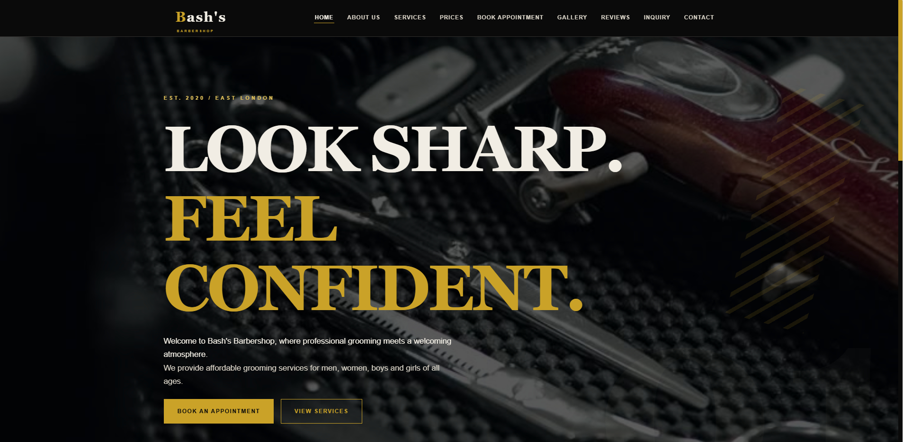
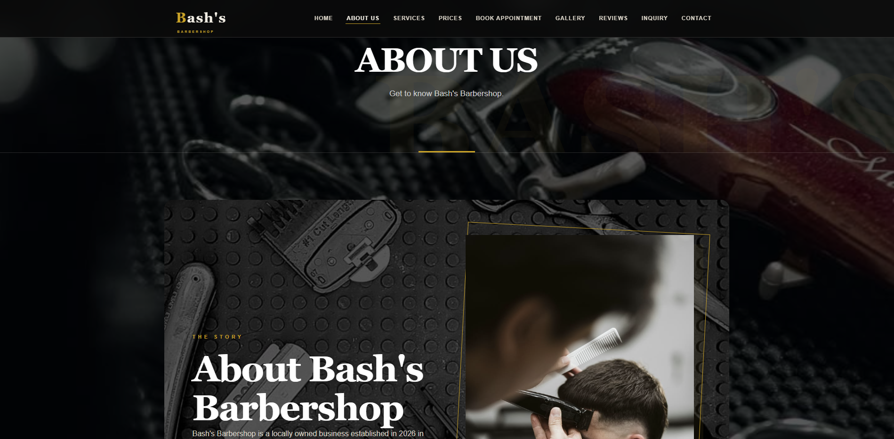
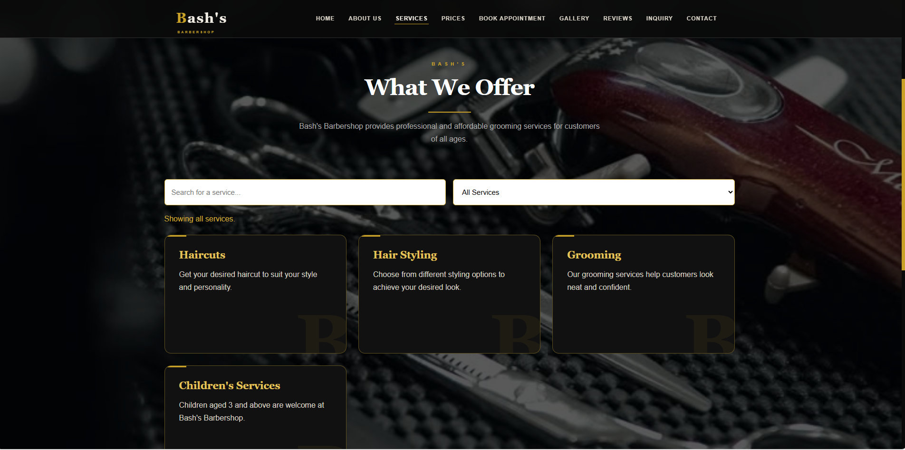
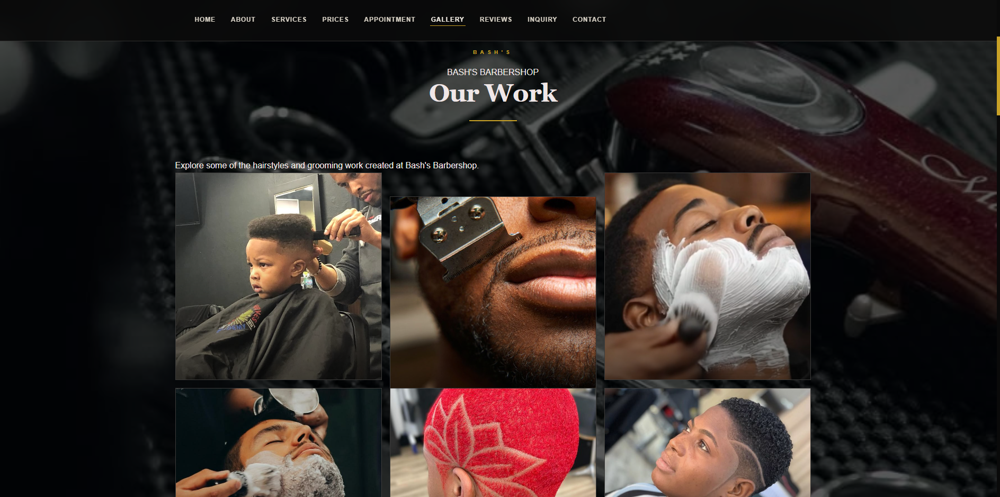
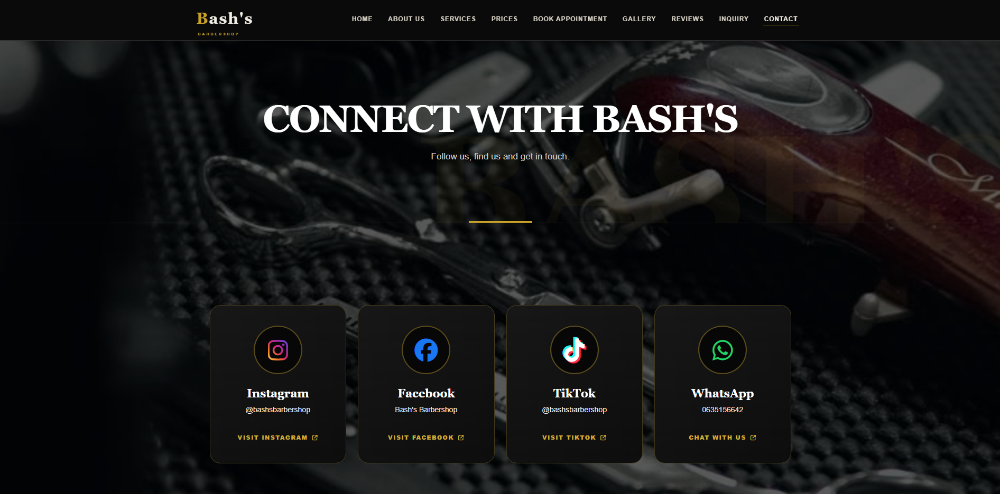
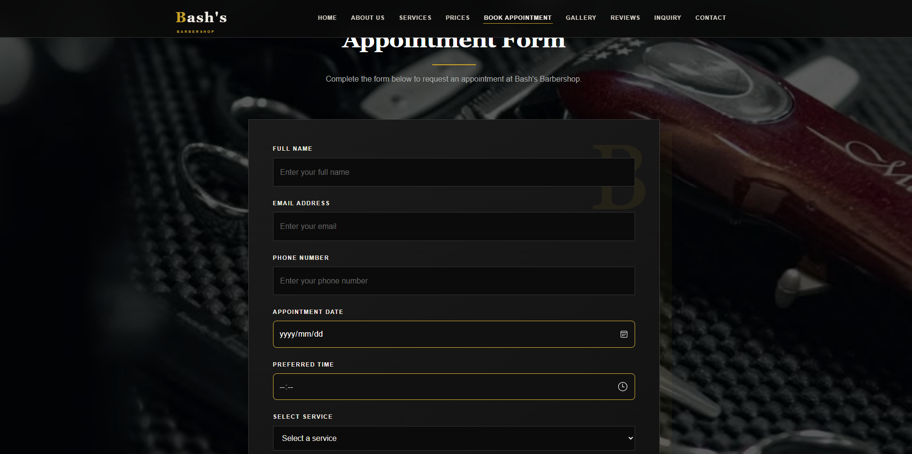
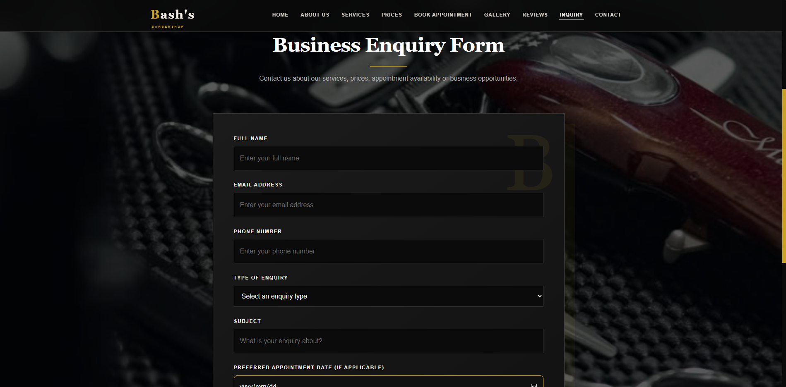
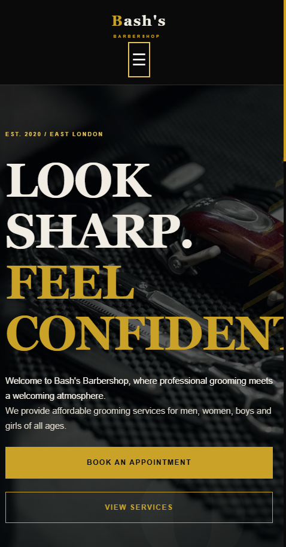

# Bash's Barbershop

## About the Project

Bash's Barbershop is a fictional barbershop website created for my web development project. My main goal was to design a website that looks and feels like something a real barbershop could use instead of a basic school website.

The website allows customers to learn about the barbershop, explore services and prices, view haircut styles, request appointments, read reviews and find contact information.

## Design

I chose a dark colour scheme with gold details because I felt it matched the style and atmosphere of a professional barbershop.

I used images throughout the website to make it more attractive and give customers a better idea of the different haircut styles. I also kept the colours, headings, buttons and navigation consistent across the pages.

Hover effects, animations and interactive features were added to improve the user experience.

## Website Pages

The website contains the following pages:

- **Home:** Introduces the barbershop and its services.
- **About Us:** Explains the barbershop's background, mission and values.
- **Services:** Displays available grooming services.
- **Prices:** Provides information about service prices.
- **Appointment:** Allows customers to request an appointment.
- **Gallery:** Displays different haircut styles and images.
- **Reviews:** Allows customers to share their experiences.
- **Inquiry:** Allows customers to ask questions about services, prices and availability.
- **Contact:** Provides contact details, social media links and location information.

## Project Features

The website includes the following features:

- Multi-page website with connected navigation.
- Responsive layouts for desktop, tablet and mobile devices.
- Interactive mobile navigation menu.
- Service search and filtering functionality.
- Image gallery with a lightbox that allows customers to enlarge images.
- Dynamic welcome message on the home page.
- Back-to-top button.
- Interactive map using Leaflet and OpenStreetMap.
- Appointment request form with date and input validation.
- Separate contact and business enquiry forms.
- HTML5 form validation and JavaScript validation.
- Social media and WhatsApp links.
- Google Maps directions.
- Hover effects and CSS transitions.

## Forms and Functionality

I added different forms to make the website more useful for customers.

The appointment form collects customer details, preferred dates, times and selected services. It also prevents customers from selecting a past date.

The inquiry form allows customers to ask about services, prices, availability and other business-related questions.

The contact form allows customers to send general questions, feedback and other messages.

The forms use HTML5 and JavaScript validation. FormSubmit is used as the external service for delivering form submissions to the email address configured in the form.

The email recipient must activate FormSubmit before submissions can be delivered successfully.

## Responsive Design

I made the website responsive so that it can be viewed on different screen sizes.

I used CSS media queries to adjust layouts, images, forms, cards, typography and navigation for smaller devices.

After receiving feedback on my previous submission, I also improved the About page layout and text sizes on smaller screens to prevent the content from appearing too crowded or difficult to read.

## SEO and Accessibility Improvements

I included page titles and meta descriptions to help search engines understand the content of the website.

I also used heading structures, descriptive image alternative text, internal links and responsive layouts.

Form labels and helpful validation messages were added to make the forms easier to use. The interactive map also includes an accessible label.

## Challenges and Improvements

While working on the website, I experienced problems with some page layouts, mobile responsiveness and interactive features.

I made changes to the CSS, HTML and JavaScript to improve the appearance and functionality of the website.

I also worked on the feedback from my previous submission. These improvements included:

- Adjusting the About page typography and layout for smaller devices.
- Improving the mobile navigation.
- Adding more information to the README.
- Recording CSS and JavaScript improvements in the changelog.
- Adding a section for project screenshots and references.

This helped me understand that website development involves testing, identifying problems and making improvements throughout the process.

## Changelog

### Part 1
- Created the initial website structure.
- Added the main website pages and navigation.

### Part 2
- Created an external CSS stylesheet.
- Added typography, colours, backgrounds and page layouts.
- Added hover effects and responsive media queries.
- Improved the navigation menu and image layouts.

### Part 3
- Improved the About page layout and typography for mobile devices.
- Added CSS styling for the mobile navigation menu.
- Added styling for the back-to-top button and dynamic welcome message.
- Added CSS styling for the gallery lightbox.
- Added CSS styling for the interactive map.
- Added JavaScript for mobile navigation and back-to-top functionality.
- Added a gallery lightbox with image enlargement and closing functionality.
- Added an interactive Leaflet map.
- Added a service search and filter feature.
- Added JavaScript validation for the appointment, contact and inquiry forms.
- Added form submission through FormSubmit.
- Improved page titles and meta descriptions.
- Updated this README with project information, features, screenshots and references.

## Screenshots

Screenshots of the completed website should be placed in a folder named `screenshots` in the main project directory.

The screenshots should show:

1. Home page.
2. About page.
3. Services page with the search and filter feature.
4. Gallery page with the lightbox open.
5. Contact page with the interactive map.
6. Appointment form.
7. Inquiry and contact forms.
8. Website displayed on a mobile screen.

## Technologies and Tools Used

- HTML5
- CSS3
- JavaScript
- Leaflet.js
- OpenStreetMap
- Font Awesome
- FormSubmit
- Visual Studio Code
- Git and GitHub
- Live Server
- GitHub Pages

## How to Run the Website

1. Download or clone the project repository from GitHub.
2. Open the project folder in Visual Studio Code.
3. Open the `index.html` file using Live Server. 
4. Navigate through the website using the navigation menu.
5. An internet connection is required for external resources such as the map, icons and form submission service.

## Live Website

[Visit Bash's Barbershop](https://achuma-dikani.github.io/BASH-Barbershop/)

## GitHub Repository

[View the GitHub Repository](https://github.com/achuma-dikani/BASH-Barbershop)

## References

- Font Awesome (2026). *Font Awesome Icons*. Available at: https://fontawesome.com/
- FormSubmit (2026). *FormSubmit Documentation*. Available at: https://formsubmit.co/
- Leaflet (2026). *Leaflet Documentation*. Available at: https://leafletjs.com/
- OpenStreetMap (2026). *OpenStreetMap*. Available at: https://www.openstreetmap.org/
- GitHub (2026). *GitHub Pages Documentation*. Available at: https://docs.github.com/en/pages

## Screenshots

### Home Page

### About Page

### Services Page

### Gallery Page

### Contact Page

### Appointment Page

### Inquiry Page

### Mobile View

## Author

Achuma Dikani

## Year

2026